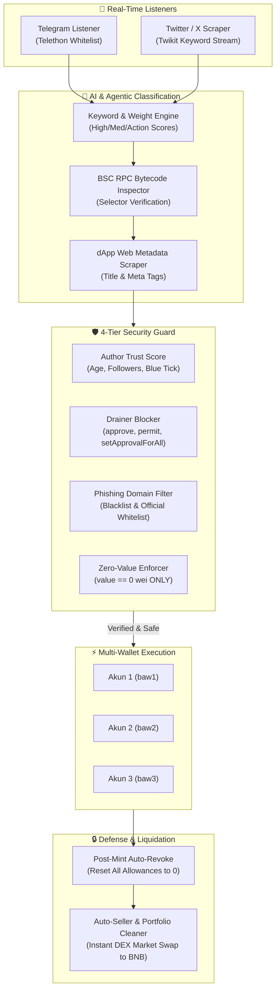

# 🤖 Binance Agentic Wallet & Airdrop Sniper Suite

[-F0B90B?style=for-the-badge&logo=binance&logoColor=black)](https://bscscan.com)
[](https://python.org)
[](https://github.com/SiNopaal/Binance-Agentic-Wallet)
[](https://github.com/SiNopaal/Binance-Agentic-Wallet)
[](LICENSE)

An enterprise-grade, autonomous **Binance Agentic Wallet (BAW)** management engine and real-time **Free-Mint Airdrop Sniper** built specifically for the BNB Chain Agentic Ecosystem, `.ai` Agent ID Registries, and AI Agent token drops.

---

## 📑 Table of Contents
- [Architecture Overview](#-architecture-overview)
- [Key Features](#-key-features)
- [Security Model & Anti-Drainer Shield](#-security-model--anti-drainer-shield)
- [Multi-Profile BAW Infrastructure](#-multi-profile-baw-infrastructure)
- [Directory Structure](#-directory-structure)
- [Getting Started](#-getting-started)
- [Configuration (.env)](#-configuration-env)
- [Usage & Commands](#-usage--commands)
- [Automated 7-Point Audit](#-automated-7-point-audit)
- [Panduan Bahasa Indonesia](#-panduan-ringkas-bahasa-indonesia)
- [Disclaimer & License](#-disclaimer--license)

---

## 🏛️ Architecture Overview



---

## ✨ Key Features

1. **Dual-Channel Alpha Scraper**:
   - **Telegram Streamer**: Asynchronously listens only to whitelisted alpha channels (e.g., Airdrop Umbrella, Bit_ID, NexGen, CloudJP, FamilyIDN). All noise and spam groups are discarded.
   - **Twitter / X Streamer**: Live keyword queries tracking Binance Agentic Wallet, `.ai` domains, ERC-6551 tokens, and Agent ID contracts.

2. **3-Layer Agentic & `.ai` Filter**:
   - Regex-based scoring across high/medium priority keywords.
   - Live BSC RPC inspection verifying contract bytecode and known mint/claim function selectors (`0x8580974c`, `0x1249c58b`, `0xa0712d68`, etc.).
   - Web scraper analyzing external dApp landing pages for AI-agent signals.

3. **Multi-Profile Concurrent Engine**:
   - Run up to 3 (or more) Binance Agentic Wallets concurrently on the same machine.
   - Completely circumvents Windows Keytar credential overwriting and session collisions.

4. **Zero-Cost Free Mint Enforcer**:
   - Transactions requiring native BNB payment (`value > 0`) are instantly rejected.
   - Wallet balances are **strictly reserved for gas fees only**.

5. **Post-Mint Auto-Revoke**:
   - Immediately following every mint or claim transaction, the executor queries on-chain token allowances and executes `approvals revoke` across all spender addresses.

6. **Autonomous DEX Liquidation (Auto-Seller)**:
   - Scans wallet balances across all accounts.
   - Automatically queries PancakeSwap DEX quotes and liquidates freshly minted tokens into native BNB while protecting valuable passes and relics.

---

## 🛡️ Security Model & Anti-Drainer Shield

The suite operates under a **Zero-Trust Security Principle** to protect wallet funds against malicious airdrops, fake mints, and wallet drainers:

| Layer | Mechanism | Protection Scope |
| :--- | :--- | :--- |
| **Tier 1: Local Code Enforcer** | Pre-flight validation | Any transaction with `value > 0` is aborted immediately. |
| **Tier 2: Function Selector Guard** | Bytecode inspection | Blocks trap selectors: `approve()` (`0x095ea7b3`), `setApprovalForAll()` (`0xa22cb465`), `permit()` (`0xd505accf`). |
| **Tier 3: Node Simulation** | Live RPC simulation | Tests contract call with `--value 0`. If contract requires payment or reverts, simulation fails and no transaction is signed. |
| **Tier 4: Post-Mint Auto-Revoke** | Automated allowance sweep | Clears any residual or unauthorized token allowances after execution. |

---

## 💼 Multi-Profile BAW Infrastructure

By default, the Binance Agentic Wallet CLI stores credentials in a single global service vault and shares the machine hostname. This project solves this with:
- **`BINANCE_KEYTAR_SERVICE`**: Assigns independent vault names (`baw_acc1`, `baw_acc2`, `baw_acc3`).
- **`BINANCE_BAW_DIR`**: Isolates database directories per account (`profiles/acc1`, `profiles/acc2`, `profiles/acc3`).
- **`preload.cjs`**: Preload hook intercepting `os.hostname()` to present distinct virtual node identities to Binance backend.

CLI wrappers are provided:
- `baw1`: Controls Account 1
- `baw2`: Controls Account 2
- `baw3`: Controls Account 3

---

## 📁 Directory Structure

```
Binance-Agentic-Wallet/
├── .gitignore                      # Git ignore rules (secrets, caches, logs)
├── .env.example                    # Template environment file
├── requirements.txt                # Python package dependencies
├── target_channels.txt             # Whitelist of target Telegram channels
├── config.py                       # Global configurations, keywords, and endpoints
├── agentic_detector.py             # 3-Layer Agentic & .ai classification engine
├── security_guard.py               # 4-Tier Anti-Drainer and Scam detector
├── executor.py                     # Multi-wallet free-mint runner & auto-revoker
├── auto_seller.py                  # DEX market liquidation to native BNB
├── telegram_listener.py            # Telethon async Telegram monitor
├── x_listener.py                   # Twikit Twitter/X scraper with author auditor
├── audit_system.py                 # Automated 7-point pre-flight audit suite
├── main.py                         # Unified daemon entrypoint
│
├── run_agentic_sniper.bat          # 1-Click Launch: Dual Scraper (Monitor Only)
├── run_auto_mint.bat               # 1-Click Launch: Auto-Mint (3 Wallets)
├── clean_and_sell.bat              # 1-Click Launch: Portfolio Liquidation to BNB
├── revoke_approvals.bat            # 1-Click Launch: Instant Manual Revoke Sweep
│
└── baw-tools/                      # Multi-profile Binance Agentic Wallet tools
    ├── README.md                   # BAW Multi-Profile documentation
    ├── baw-multi.mjs               # Profile status and orchestrator CLI
    ├── preload.cjs                 # Node hostname spoofing hook
    └── setup-profile-commands.bat  # Automated wrapper installer
```

---

## 🚀 Getting Started

### 1. Prerequisites
- **Python 3.10+**
- **Node.js 18+** & npm
- **Binance Agentic Wallet CLI**:
  ```bash
  npm install -g @binance/agentic-wallet
  ```

### 2. Clone & Install
```bash
git clone https://github.com/SiNopaal/Binance-Agentic-Wallet.git
cd Binance-Agentic-Wallet

# Install Python requirements
pip install -r requirements.txt
```

### 3. Setup Multi-Profile BAW Wrappers
Run the setup script inside `baw-tools`:
```cmd
baw-tools\setup-profile-commands.bat
```
Then log in to your wallets:
```bash
baw1 login
baw2 login
baw3 login
```

### 4. Configure Environment
Copy `.env.example` to `.env` and fill in your details:
```bash
copy .env.example .env
```

---

## ⚙️ Configuration (.env)

```env
# Telegram Scraper Credentials (from https://my.telegram.org)
TELEGRAM_API_ID=2040
TELEGRAM_API_HASH=b18441a1ff607e10a989891a5462e627
TELEGRAM_SESSION_PATH=session/user.session

# Twitter / X Credentials (Cookies or accounts.json)
TWITTER_ACCOUNTS_FILE=accounts.json
TWITTER_ACCOUNT_NAME=your_username
TWITTER_AUTH_TOKEN=
TWITTER_CT0=

# Multi-Wallet Setup
WALLET_1_NAME=Account 1
WALLET_1_CMD=baw1
WALLET_1_ADDRESS=0xYourWalletAddress1

WALLET_2_NAME=Account 2
WALLET_2_CMD=baw2
WALLET_2_ADDRESS=0xYourWalletAddress2

WALLET_3_NAME=Account 3
WALLET_3_CMD=baw3
WALLET_3_ADDRESS=0xYourWalletAddress3

# Safety Thresholds
AGENTIC_SCORE_THRESHOLD=60
MAX_GAS_FEE_LIMIT_BNB=0.0004
MIN_USD_TO_SELL=0.20
```

---

## 🎮 Usage & Commands

### 1. Run Complete Automated System Audit
```bash
python audit_system.py
```

### 2. Live Monitoring (Monitor & Alert Only)
```bash
python main.py --all
```
*Or double-click `run_agentic_sniper.bat`.*

### 3. Live Auto-Minting (Autonomous Execution)
```bash
python main.py --all --auto-mint
```
*Or double-click `run_auto_mint.bat`.*

### 4. Convert Airdropped Tokens to BNB
```bash
python auto_seller.py --sell
```
*Or double-click `clean_and_sell.bat`.*

### 5. Instant Security Revoke Sweep
```bash
python executor.py --revoke-all
```
*Or double-click `revoke_approvals.bat`.*

---

## 🔍 Automated 7-Point Audit

The project includes an integrated audit script (`audit_system.py`) that performs 7 live verification checks before entering production:

1. **BSC RPC Connectivity**: Verifies Web3 connection to Chain ID 56.
2. **BAW Multi-Wallet Status**: Audits gas balances and active CLI wrappers for all 3 accounts.
3. **Agentic & .ai Detector Accuracy**: Tests AI-agent detection vs spam rejection.
4. **Anti-Scam & Drainer Blocker**: Verifies immediate blocking of drainer selectors and phishing domains.
5. **Zero-Cost Free-Mint Gating**: Ensures paid transactions are strictly rejected.
6. **Listener Credentials**: Verifies Telegram and X session viability.
7. **Post-Mint Auto-Revoke**: Tests on-chain allowance queries and revocation mechanisms.

---

## 🇮🇩 Panduan Ringkas (Bahasa Indonesia)

**Binance Agentic Wallet & Airdrop Sniper** adalah sistem automasi cerdas untuk memburu dan melakukan klaim free-mint airdrop di jaringan BNB Chain, khususnya garapan berbasis AI Agent dan domain `.ai`.

### Fitur Unggulan:
- **3 Akun Multi-Wallet Serentak**: Menjalankan 3 dompet BAW tanpa risiko bentrok session berkat sistem spoofing device & Keytar vault terisolasi.
- **Scraper 2 Arah (Telegram & X)**: Memantau 5 channel airdrop pilihan di Telegram dan kata kunci Agentic di X secara real-time.
- **Anti-Scam & Anti-Drainer Ketat**: Memblokir otomatis fungsi berbahaya (`approve`, `setApprovalForAll`, `permit`) dan domain phising.
- **Aturan Mutlak 100% Free**: Membatalkan transaksi jika ada biaya mint selain gas fee jaringan (maksimal ~$0.15-$0.20 BNB gas fee).
- **Auto-Revoke Pasca Minting**: Setiap kali selesai klaim, bot langsung mencabut semua approval aktif menjadi 0 agar saldo dompet tetap aman.
- **Auto-Seller DEX**: Mengonversi token hasil garapan langsung ke koin native BNB di PancakeSwap.

---

## ⚖️ Disclaimer & License

- **Disclaimer**: This software is intended for research, automation, and educational purposes. Use on-chain automation responsibly and ensure you understand transactions before execution. Never share your private keys or `.session` files.
- **License**: MIT License. See [LICENSE](LICENSE) for details.
