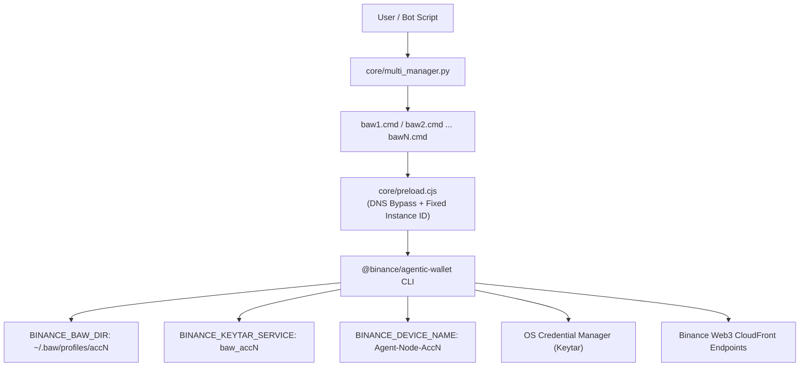

# 🤖 Binance Agentic Wallet (BAW) Multi-Account Manager

[](https://opensource.org/licenses/MIT)
[](https://nodejs.org/)
[](https://python.org/)
[](https://web3.binance.com/)

An advanced, production-grade multi-profile orchestration framework for the official **Binance Agentic Wallet (`@binance/agentic-wallet`) CLI**.

---

## 🌟 Why This Project?

By default, the Binance Agentic Wallet CLI is designed strictly for a single local user account. Storing multiple wallets natively leads to credential overwrites, session conflicts, and database corruption.

**This framework solves these limitations by providing:**
1. **Complete Profile Isolation**: Each wallet profile runs in its own sandbox with dedicated data directories and independent OS credential storage.
2. **Anti-Reset & VPN Protection (`preload.cjs`)**: Fixes a critical flaw where switching network adapters (e.g. toggling VPN, WARP 1.1.1.1, or mobile hotspot) changes the system's primary MAC address, which triggers BAW's internal encryption check to wipe all saved session tokens.
3. **ISP DNS Bypass**: Built-in DNS resolver hooks prevent regional ISP DNS blocks on Binance CloudFront endpoints.
4. **Interactive QR Sign-in Assistant**: Fast pairing code display, QR image generation, and automatic blocking verification with instant credential archiving.
5. **24/7 Keep-Alive & Auto-Recovery**: Heartbeat monitoring daemon that detects connection drops and automatically restores sessions from encrypted local backups.
6. **Batch Automation Suite**: Execute commands, audit native BNB and token balances, and broadcast smart contract calls across all accounts in parallel.

---

## 🏗️ Architecture & How It Works



Each profile is isolated via three environment variables:
* `BINANCE_BAW_DIR`: Unique directory for `session.json` and local logs.
* `BINANCE_KEYTAR_SERVICE`: Unique service key in Windows Credential Manager / macOS Keychain / Linux Secret Service.
* `BINANCE_DEVICE_NAME`: Unique agent node identifier recognized by Binance.
* `BINANCE_INSTANCE_ID`: Pinned hardware identifier ensuring sessions survive network adapter re-ordering.

---

## 📁 Repository Structure

```text
Binance-Agentic-Wallet/
├── core/
│   ├── preload.cjs                # DNS hook & fixed hardware Instance ID
│   ├── multi_manager.py           # Master CLI orchestrator for all accounts
│   ├── session_backup_restore.py  # Session token archiver & 1-click restore
│   └── keepalive_daemon.py        # 24/7 heartbeat monitor & auto-recovery
├── tools/
│   ├── qr_login_helper.py         # Terminal QR generator & auto-verifier
│   ├── setup_profiles.bat         # Windows shortcut generator (baw1, baw2, ...)
│   └── setup_profiles.sh          # Linux/macOS shortcut generator
├── scripts/
│   ├── batch_balance_checker.py   # Multi-wallet BNB & token balance auditor
│   └── batch_contract_call.py     # Batch smart contract call executor
├── config/
│   └── accounts.example.json      # Account configuration template
├── .env.example                   # Environment variable template
├── .gitignore                     # Comprehensive secret & token exclusion
├── AGENTS.md                      # Complete machine-readable guide for AI agents
├── package.json                   # NPM dependencies
├── requirements.txt               # Python dependencies
└── README.md
```

---

## 🚀 Quick Start Guide

### 1. Prerequisites
Ensure you have the following installed:
* **Node.js** (v18 or higher)
* **Python** (v3.9 or higher)
* **Binance Agentic Wallet CLI**:
  ```bash
  npm install -g @binance/agentic-wallet
  ```

### 2. Clone & Install Dependencies
```bash
git clone https://github.com/SiNopaal/Binance-Agentic-Wallet.git
cd Binance-Agentic-Wallet

# Install Python requirements
pip install -r requirements.txt
```

### 3. Setup Profiles
1. Copy the example configuration:
   ```bash
   cp config/accounts.example.json config/accounts.json
   ```
2. Generate your CLI shortcuts:
   * **Windows**: Run `tools\setup_profiles.bat` (Generates `baw1.cmd`, `baw2.cmd`, etc. in your user folder).
   * **Linux/macOS**: Run `bash tools/setup_profiles.sh`.

### 4. Authenticate Accounts via QR Code
Run the login helper for each account you want to connect:
```bash
python tools/qr_login_helper.py --acc 1
```
* The terminal will output the direct link, pairing code, and generate a QR image in `qr_codes/`.
* Scan the QR code using your **Binance Wallet App** on mobile.
* Confirm sign-in. The script will automatically verify and archive a safe local backup upon success.
* Repeat for `--acc 2`, `--acc 3`, etc.

### 5. Audit & Manage All Accounts
Check the connection status and on-chain addresses of all configured wallets:
```bash
python core/multi_manager.py --status
```

Run any arbitrary BAW command across all wallets:
```bash
python core/multi_manager.py --run wallet balance --json
```

Check native BNB gas balances:
```bash
python scripts/batch_balance_checker.py
```

---

## 🛡️ 24/7 Keep-Alive & Auto-Recovery

To ensure your agent squad never goes offline, run the keep-alive daemon:
```bash
python core/keepalive_daemon.py
```
* **Heartbeat**: Pings each wallet every 20 minutes (configurable via `BAW_KEEPALIVE_INTERVAL`).
* **Auto-Recovery**: If Windows Keytar drops or an account disconnects, it automatically re-injects the session from the local encrypted backup without requiring manual QR scans.

---

## 🤖 AI Agent & LLM Orchestration Guide

This repository is **Agent-Ready** and designed for seamless integration with AI Assistants and autonomous LLM agents (e.g. Antigravity, Claude Code, Cursor, AutoGPT, Cline, or custom AI workers).

A comprehensive, deterministic agent execution protocol is available in [AGENTS.md](AGENTS.md).

### 📋 System Prompt for AI Agents
To command an external AI Assistant to manage this multi-account setup safely, copy and paste this system prompt into its configuration:

```markdown
<binance_agentic_wallet_protocol>
You are an autonomous commander of a multi-wallet squad using the Binance Agentic Wallet (BAW) Multi-Manager framework.
Follow these operational rules strictly:
1. NEVER run un-sandboxed `baw`. Always route commands through `python core/multi_manager.py` or individual account wrappers (`baw1`, `baw2`, etc.).
2. Before any on-chain transaction, verify connectivity via `python core/multi_manager.py --status` and ensure gas balance is > 0.0005 BNB.
3. Every smart contract write MUST use the two-stage preview-and-execute flow (`contract-call preview` -> verify simulationCode "000000000" -> `contract-call execute`).
4. If a wallet session expires or disconnects, first run `python core/session_backup_restore.py restore` before prompting the user for QR authentication.
5. Report all executed transactions with BscScan URLs and structured status tables.
</binance_agentic_wallet_protocol>
```

### ⚡ Common Agent Execution Patterns
* **Audit entire squad connection**: `python core/multi_manager.py --status`
* **Query balances on BSC**: `python scripts/batch_balance_checker.py`
* **Run command across all wallets**: `python core/multi_manager.py --run wallet tx-history --limit 5 --json`
* **Restore dropped credentials**: `python core/session_backup_restore.py restore`

---

## 🔒 Security & OPSEC Best Practices

> [!CAUTION]
> **NEVER COMMIT CREDENTIALS TO GIT!**
> The provided `.gitignore` is strictly configured to ignore:
> * `profiles/` and `~/.baw/` (Session files)
> * `backups/` and `*keytar*` (Credential Manager secrets)
> * `qr_codes/` and `*.log`
> * `config/accounts.json` and `.env`

Before pushing any changes to your fork, always verify with:
```bash
git status
```
Ensure no private keys, session tokens, or real wallet files are staged.

---

## 📜 License
This project is open-source and released under the [MIT License](LICENSE).

---

## ⚠️ Disclaimer
*This project is an independent community automation framework and is not officially affiliated with or endorsed by Binance. Use at your own risk. Always test with small gas amounts before running large automated workflows.*
